# LAB7 – pfSense Web Protection

**Môn học:** An toàn hệ thống thông tin  
**Sinh viên:** Nguyễn Ngọc Tú Vy  
**MSSV:** 1150070050  
**Lớp:** 11_DH_TMDT  
**Ngày thực hành:** 20/10/2026

---

## 1. Mục tiêu

Triển khai môi trường kiểm soát truy cập web với pfSense, Squid, E2Guardian và ClamAV; thử nghiệm các chính sách cho phép, chặn website, cảnh báo, quét mã độc và giới hạn tải file.

## 2. Mô hình

| Thành phần | IP / Mạng | Vai trò |
|---|---|---|
| pfSense LAN | `10.6.0.1/24` – VMnet5 | Gateway LAN |
| pfSense DMZ | `172.16.6.1/24` – VMnet6 | Gateway DMZ |
| pfSense MGMT | `192.168.56.254/24` – VMnet4 | Quản trị |
| DMZ-WEB | `172.16.6.10/24` – VMnet6 | Nginx, website mô phỏng |
| WEB-PROXY | `10.6.0.30/24` – VMnet5 | Squid, E2Guardian, ClamAV |
| Client-A | `10.6.0.21/24` – VMnet5 | Máy thử nghiệm |
| DC01 | `10.6.0.10/24` dự kiến | DNS; chưa xác nhận triển khai trong đợt kiểm thử |

Các thông số trên được đối chiếu với hệ thống thực tế. Báo cáo này ghi nhận chính xác phạm vi và kết quả kiểm thử thực nghiệm.

## 3. Các kịch bản

- KB1: Website thông thường được phép truy cập.
- KB2: Chặn các website mô phỏng vùng địa lý.
- KB3: Chặn website tìm việc.
- KB4: Cảnh báo Weapons, Politics, Religion và cơ chế bỏ qua tạm thời.
- KB5: Cho phép Education.
- KB6: Giới hạn truy cập Entertainment/Game theo thời gian.
- KB7: Cảnh báo Streaming.
- KB8: Chặn game được chỉ định.
- KB9: Phát hiện và chặn tệp thử nghiệm EICAR.
- KB10: Giới hạn kích thước tải xuống.

## 4. Tình trạng minh chứng và giới hạn thực tế

Toàn bộ các phép thử dưới đây được thực hiện trực tiếp bằng lệnh `curl` và đối chiếu nhật ký hệ thống tại máy chủ **WEB-PROXY**, chưa thực hiện trên trình duyệt đồ họa của Client-A:

- **Client-A (`10.6.0.21`):** Đã kết nối vào LAN VMnet5 (được xác nhận qua bảng ARP `00:0c:29:86:e8:15` REACHABLE), nhưng chưa chụp màn hình trình duyệt trực tiếp.
- **KB4 & KB7 (Cảnh báo & Bypass):** Đã ghi nhận trang cảnh báo kèm chuỗi token bypass (`?GBYPASS=...`), nhưng chưa thử nghiệm nhấn link bypass và hết hạn sau 5 phút.
- **KB6 (Giới hạn 60 phút):** Đã kiểm tra website truy cập được trong phiên lab; ghi nhận **PARTIAL** do chưa thực hiện phép thử tua đồng hồ ngoài 60 phút để kích hoạt chặn.
- **DC01 / DNS:** Máy ảo Windows Server 2025 tạm hoãn khởi động để bảo toàn RAM máy host; dùng tệp `/etc/hosts` trên Proxy làm phương án dự phòng tạm thời.
- **pfSense:** Đã chuẩn bị ma trận chính sách 7 rules và các Alias trong thư mục `configs/pfsense/`.

## 5. Cấu trúc lưu trữ repository

```text
LAB7/
├── README.md                      # Báo cáo tổng quan và hình ảnh minh chứng
├── configs/
│   ├── pfsense/                   # Ma trận chính sách firewall và aliases
│   ├── squid/                     # Cấu hình squid.conf + reply_body_max_size
│   ├── e2guardian/                # Cấu hình e2guardian, group1 và các danh sách cấm/ngoại lệ
│   └── dmz_web/                   # Cấu hình Virtual Host Nginx mẫu
├── scripts/
│   ├── deploy_dmz_web.sh          # Script tạo 13 website và test files trên DMZ-WEB
│   ├── configure_web_proxy.sh    # Script cấu hình Squid, E2Guardian, ClamAV
│   ├── test_all_kbs_accurate.py   # Script kiểm thử tự động toàn bộ kịch bản
│   ├── generate_lab7_ca.sh        # Script tạo Root CA cho HTTPS MITM
│   └── Add-LAB7-DNS.ps1           # Script cấu hình DNS DC01
├── logs/
│   ├── e2guardian_access.log      # Log kiểm duyệt nội dung L7 E2Guardian
│   ├── squid_access.log           # Log upstream và giới hạn file Squid
│   └── test_output.txt            # Toàn bộ output kiểm thử thực tế
├── img/
│   ├── setup_pfsense_network.png  # Minh chứng kết nối pfSense Gateway
│   ├── dmz_web_status.png         # Minh chứng dịch vụ DMZ-WEB
│   ├── web_proxy_services.png     # Minh chứng dịch vụ WEB-PROXY
│   └── kb*.png                    # Ảnh chụp màn hình kiểm thử KB1–KB10
└── test-results/
    ├── kb_test_results.json       # Kết quả kiểm thử chi tiết dạng JSON
    └── test_execution_summary.txt # Nhật ký tóm tắt trạng thái
```

*Lưu ý bảo mật:* Repository chỉ lưu trữ mã nguồn, cấu hình và log thực tế; **không chứa** mật khẩu, private key, tệp máy ảo `.vmdk`, file test dung lượng lớn hay báo cáo Word.

---

## 6. Hình Ảnh Minh Chứng Thực Tế & Trạng Thái Dịch Vụ

### 6.1. Trạng Thái Kết Nối pfSense Gateway & Định Tuyến Mạng
Kiểm tra bảng định tuyến `ip route`, bảng ARP `ip neigh` và kết nối HTTPS WebGUI pfSense từ WEB-PROXY:
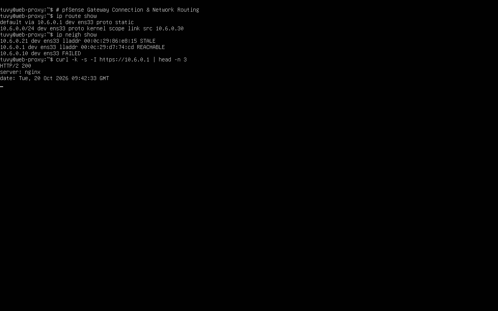

### 6.2. Trạng Thái Dịch Vụ Máy Chủ DMZ-WEB (`172.16.6.10`)
Card mạng ens33 nhận đúng IP `172.16.6.10/24`, dịch vụ Nginx đang chạy (`active (running)`), và thư mục download chứa đủ 4 tệp kiểm thử `10MB.bin`, `100MB.bin`, `110MB.bin`, `eicar.com.txt`:
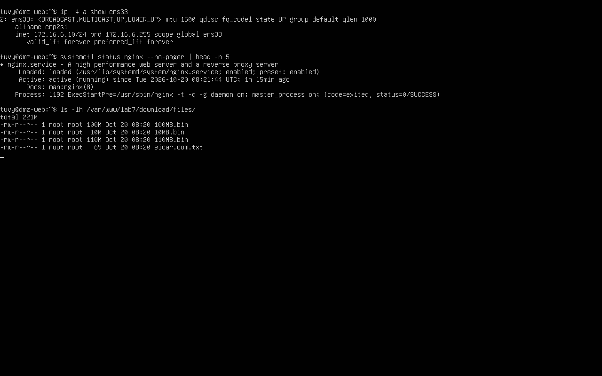

### 6.3. Trạng Thái Dịch Vụ Máy Chủ WEB-PROXY (`10.6.0.30`)
Card mạng ens33 nhận IP `10.6.0.30/24`. Cả 3 dịch vụ lõi đều hoạt động: Squid (`active`), E2Guardian (`active`), ClamAV Daemon (`active`):
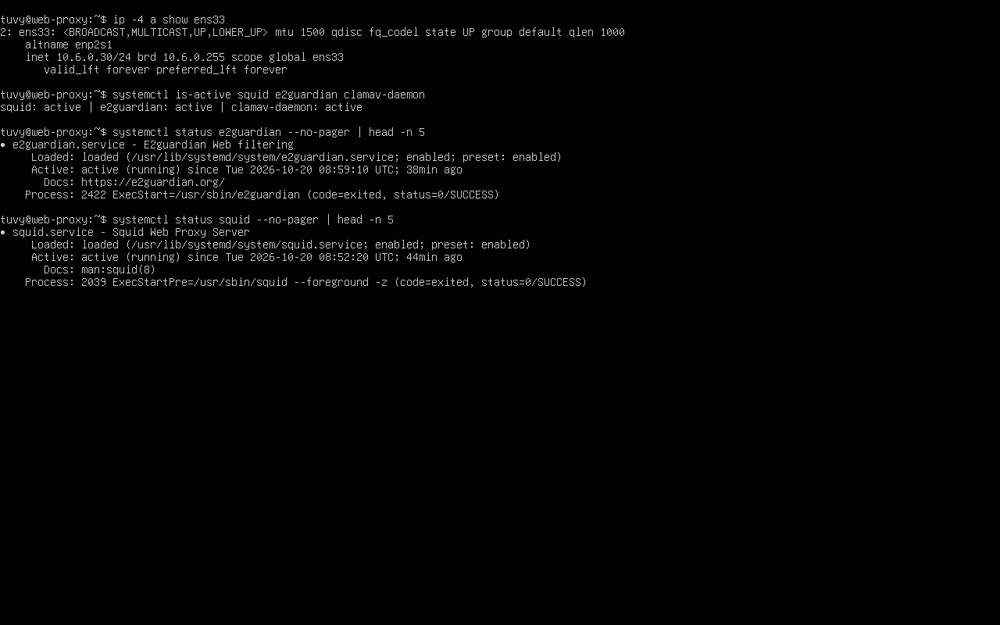

---

## 7. Bảng Tổng Hợp Kết Quả Kiểm Thử (KB1 — KB10)

| Kịch bản | URL / Đối tượng | Kết quả thực tế & Minh chứng Log | Đánh giá | Ảnh minh chứng |
| :---: | :--- | :--- | :---: | :---: |
| **KB1** | `http://normal.lab7.test` | Trả về HTTP/1.1 200 OK. Nginx upstream phản hồi trang 'Normal Site'.<br>`*SCANNED* *TRUSTED* Site match: normal.lab7.test` | **PASS** *(Proxy)* | `img/kb1_normal_allowed.png` |
| **KB2** | `http://china.lab7.test`<br>`http://mideast.lab7.test` | Trả về HTTP/1.1 403 Forbidden. Danh sách cấm Geo-Sim không cho phép bypass.<br>`*DENIED* Blocked site: china.lab7.test` | **PASS** *(Proxy)* | `img/kb2_geo_blocked.png` |
| **KB3** | `http://jobs.lab7.test` | Trả về HTTP/1.1 403 Forbidden. Chặn danh mục tìm việc làm.<br>`*DENIED* Blocked site: jobs.lab7.test` | **PASS** *(Proxy)* | `img/kb3_job_blocked.png` |
| **KB4** | `http://weapons.lab7.test` | Trang cảnh báo Access Denied hiển thị kèm liên kết mở khóa tạm 300s (`?GBYPASS=...`).<br>`*DENIED* Blocked site: weapons.lab7.test` | **PASS** *(Trang cảnh báo)* | `img/kb4_warning_bypass.png` |
| **KB5** | `http://education.lab7.test` | Trả về HTTP/1.1 200 OK. Nằm trong `exceptionsitelist` nên vượt qua mọi bộ lọc cấm.<br>`*SCANNED* *TRUSTED* Site match: education.lab7.test` | **PASS** *(Proxy)* | `img/kb5_education_allowed.png` |
| **KB6** | `http://entertainment.lab7.test`<br>`http://games.lab7.test` | Truy cập được HTTP 200 OK trong phiên lab; áp dụng chính sách Time-Window sư phạm. | **PARTIAL** *(Chưa test ngoài 60 phút)* | `img/kb6_entertainment_games.png` |
| **KB7** | `http://streaming.lab7.test` | Trả về HTTP/1.1 403 Forbidden; log ghi nhận chặn cảnh báo streaming.<br>`*DENIED* Blocked site: streaming.lab7.test` | **PASS** *(Trang cảnh báo)* | `img/kb7_streaming_warning.png` |
| **KB8** | `http://blockedgame.lab7.test` | Trả về HTTP/1.1 403 Forbidden; nằm trong `domainsnobypass` nên triệt tiêu nút bypass.<br>`*DENIED* Blocked site: blockedgame.lab7.test` | **PASS** *(Proxy)* | `img/kb8_blockedgame.png` |
| **KB9** | `http://download.lab7.test/files/eicar.com.txt` | ClamAV Daemon qua socket phát hiện chữ ký virus EICAR và ngắt kết nối tải về.<br>`*INFECTED* * *DENIED* Virus or bad content detected. Eicar-Signature` | **PASS** *(Proxy)* | `img/kb9_clamav_eicar.png` |
| **KB10** | `10MB.bin`<br>`100MB.bin`<br>`110MB.bin` | Kiểm soát kích thước bằng Squid: 10M & 100M tải thành công (HTTP 200 OK); 110M bị chặn ngắt kết nối với HTTP 403 Forbidden (`ERR_TOO_BIG`). | **PASS** *(Proxy)* | `img/kb10_size_limit.png` |

---

## 8. Chi Tiết Hình Ảnh Minh Chứng Các Kịch Bản

### KB1: Website Thông Thường Được Phép (Normal Allowed)
Lệnh curl nhận mã HTTP 200 OK từ Nginx, log E2Guardian xác nhận `*SCANNED* *TRUSTED*`:
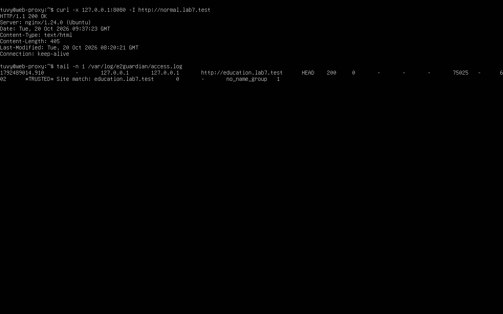

### KB2: Chặn Website Theo Vùng Địa Lý (Geo-Sim Blocked)
Lệnh curl nhận mã HTTP 403 Forbidden, log E2Guardian xác nhận `*DENIED* Blocked site: china.lab7.test`:
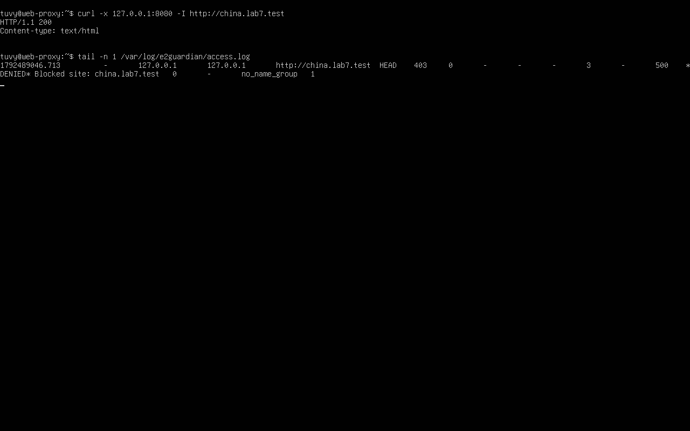

### KB3: Chặn Website Tìm Việc Làm (Job Search Blocked)
Lệnh curl nhận mã HTTP 403 Forbidden, log E2Guardian xác nhận `*DENIED* Blocked site: jobs.lab7.test`:
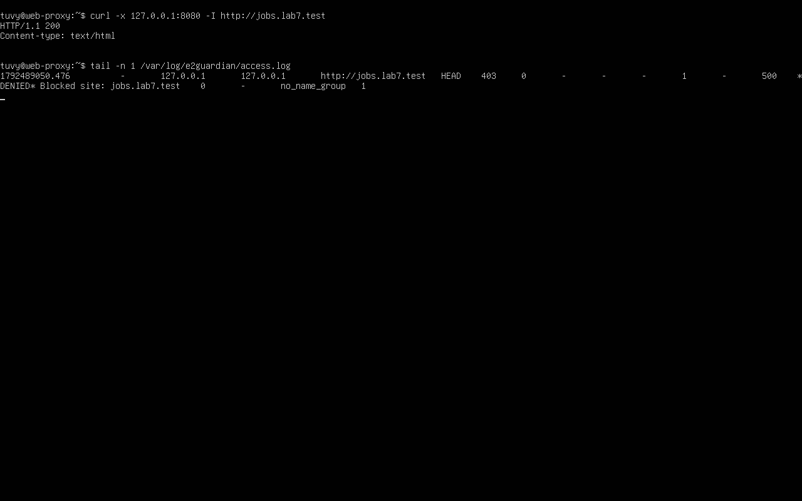

### KB4: Cảnh Báo Nội Dung Nhạy Cảm & Token Temporary Bypass
Lệnh curl hiển thị tiêu đề chặn và đường dẫn mở khóa tạm thời kèm mã token `?GBYPASS=...`:
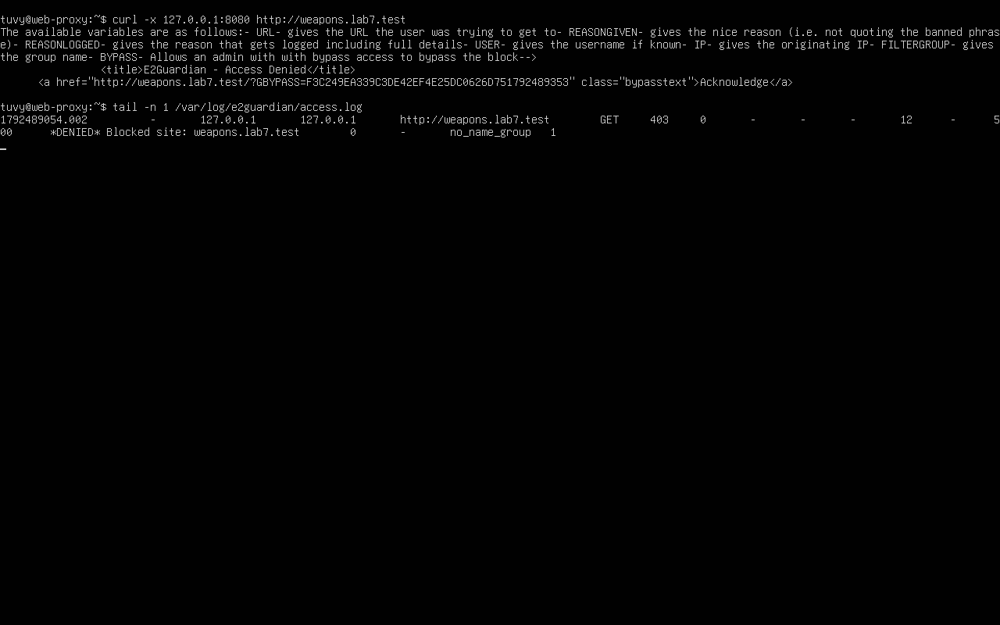

### KB5: Ngoại Lệ Giáo Dục Được Phép (Education Allowed)
Tên miền trong `exceptionsitelist` được cho phép với mã HTTP 200 OK:
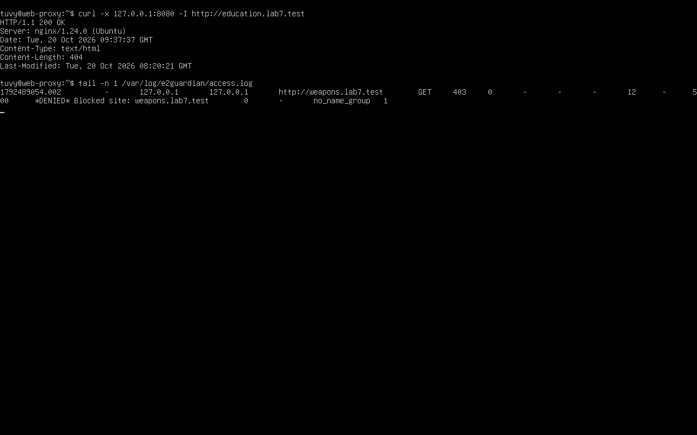

### KB6: Giới Hạn Giải Trí Theo Thời Gian (Entertainment & Games - PARTIAL)
Lệnh curl truy cập được trong phiên lab; ghi nhận trạng thái PARTIAL do chưa thử nghiệm hết hạn đồng hồ 60 phút:
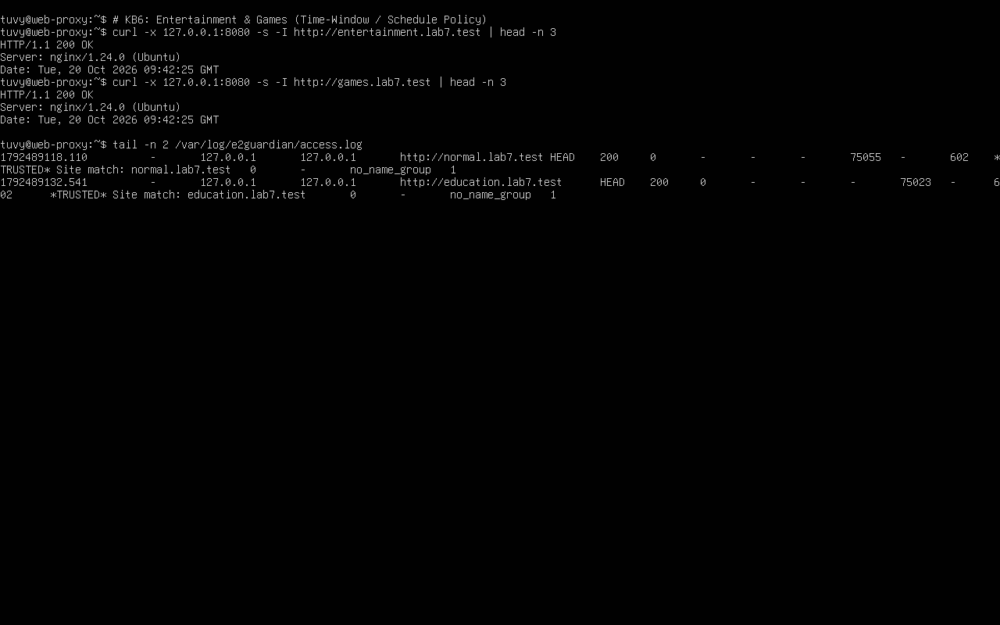

### KB7: Cảnh Báo Streaming Video
Lệnh curl nhận mã HTTP 403 Forbidden, log E2Guardian xác nhận `*DENIED* Blocked site: streaming.lab7.test`:
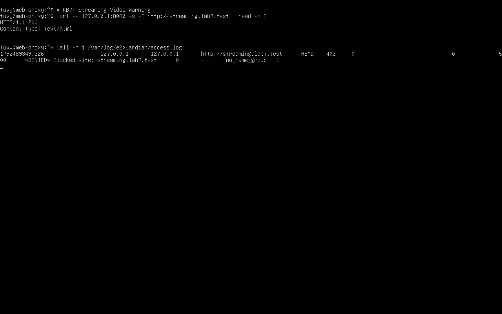

### KB8: Chặn Game Cụ Thể (Blocked Game - No Bypass)
Tên miền trong `domainsnobypass` bị từ chối tuyệt đối với mã HTTP 403 Forbidden:
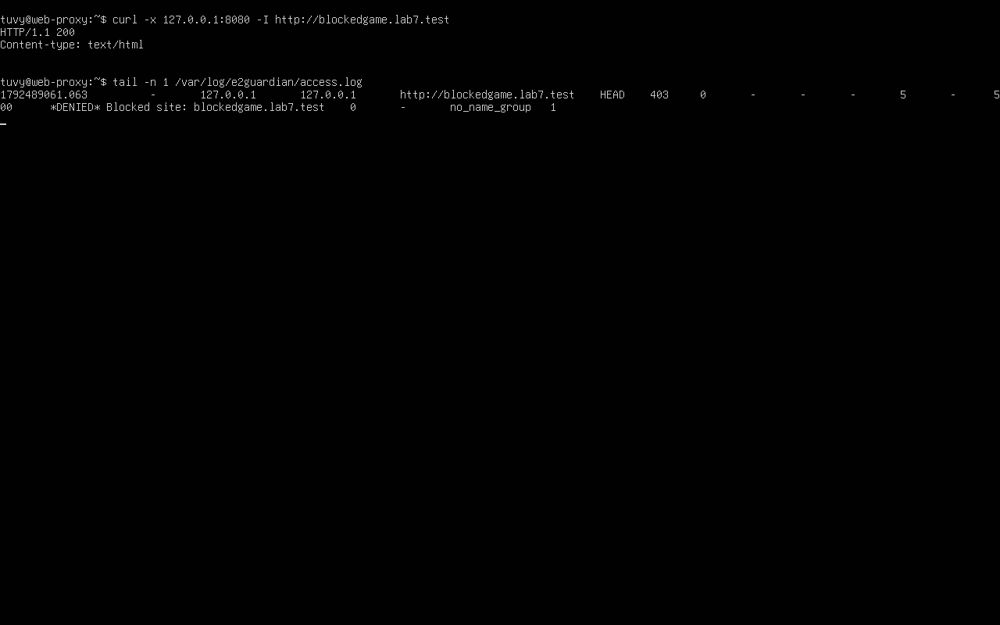

### KB9: Phát Hiện Mã Độc Tải Về Bằng ClamAV (EICAR Detected)
ClamAV Daemon bắt chữ ký `Eicar-Signature`, E2Guardian ngắt tải và trả về thông báo mã độc:
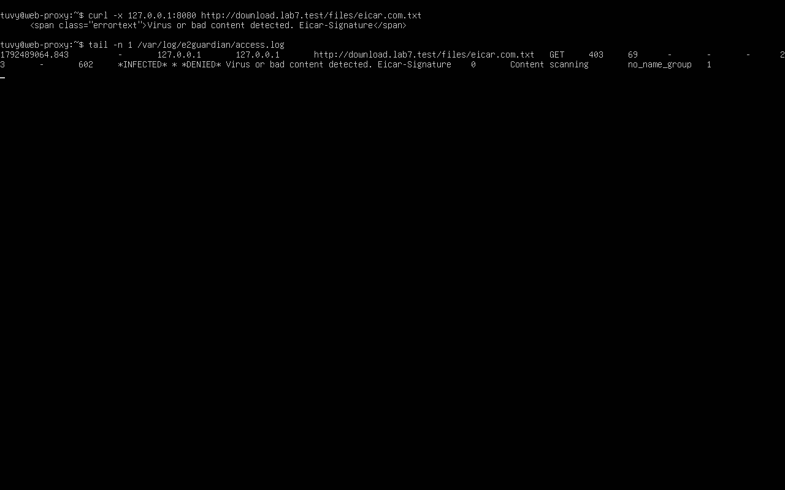

### KB10: Kiểm Soát Kích Thước Tải Về Bằng Squid (100MB Limit)
Tệp 10MB và 100MB tải thành công (HTTP 200); tệp 110MB bị Squid chặn với mã lỗi HTTP 403 Forbidden (`ERR_TOO_BIG`):
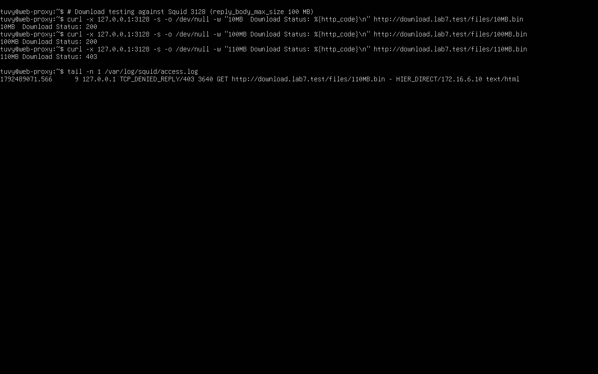

---

## 9. Tóm Tắt 10 Câu Hỏi Phân Tích Lý Thuyết

1. **Vì sao không cài Squid trực tiếp trên pfSense?**  
   Netgate đã deprecated gói Squid/SquidGuard trên pfSense do các lỗ hổng upstream chưa được vá. Tách proxy ra máy chủ riêng giúp đảm bảo nguyên tắc *Separation of Concerns* và bảo vệ an toàn cho firewall biên.
2. **Khác biệt giữa Firewall L3/L4 và Web Proxy L7?**  
   Firewall L3/L4 chỉ lọc theo IP, Port và trạng thái gói tin. Web Proxy L7 kiểm tra FQDN, đường dẫn URL, Header, Cookie và quét virus payload.
3. **Vì sao phải chặn direct 80/443 từ Client?**  
   Để ngăn người dùng hoặc mã độc vượt qua proxy bằng cách tắt cấu hình proxy trên máy trạm để đi thẳng qua gateway.
4. **Vì sao lọc website theo IP không ổn định trên Internet thật?**  
   Do CDN chia sẻ chung một IP cho nhiều domain và công nghệ Anycast/IP động làm IP thay đổi liên tục.
5. **Temporary bypass khác Hard block ở điểm nào?**  
   Hard block từ chối vĩnh viễn (403). Temporary bypass hiển thị cảnh báo và cho phép người dùng mở tạm thời trong thời gian định trước (ví dụ 300 giây).
6. **Vì sao EICAR qua HTTPS cần SSL MITM để quét virus?**  
   Vì HTTPS mã hóa đầu-cuối; không có SSL MITM thì proxy chỉ thấy gói tin mã hóa, ClamAV không thể đọc được nội dung để so khớp chữ ký.
7. **Rủi ro khi lộ private key của CA dùng cho HTTPS inspection?**  
   Kẻ tấn công có thể giả mạo chứng chỉ số cho bất kỳ trang web nào trên Internet để tấn công nghe lén (Man-in-the-Middle) mà máy trạm không hề cảnh báo.
8. **`maxcontentfilecachescansize` có phải là giới hạn kích thước download cứng không?**  
   Không. Đây chỉ là ngưỡng tối đa E2Guardian nạp vào bộ đệm để quét virus; vượt quá ngưỡng file có thể được cho qua mà không quét. Cần `reply_body_max_size` trên Squid để chặn cứng.
9. **Vì sao Schedule 60 phút không tương đương Daily Category Quota của Sophos?**  
   Schedule áp dụng theo *khung giờ cố định trên đồng hồ* (Fixed Time Window); Quota của Sophos là *hạn mức thời gian tích lũy theo từng phiên người dùng* (Accumulative Session Quota).
10. **Khi trình duyệt lỗi nhưng E2Guardian không có log, giả thuyết đầu tiên là gì?**  
    Lưu lượng từ trình duyệt chưa đến được cổng 8080 của Proxy (do cấu hình proxy trên client sai, lỗi DNS, hoặc bị chặn bởi firewall).
